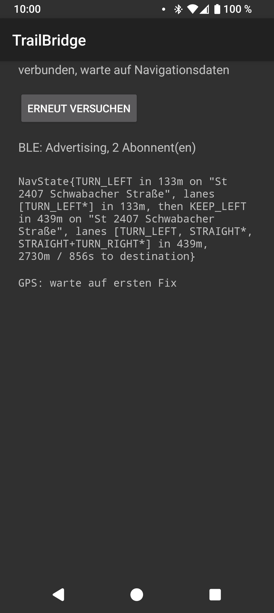
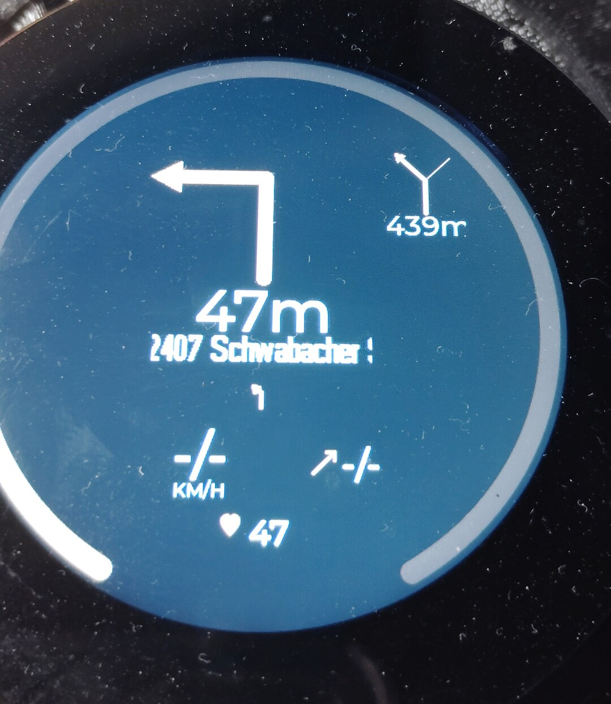

# TrailBridge

*English translation of [README.md](README.md). The German file is the authoritative version; change both together.*

Android companion app for the
[TRGB-BikeComputer](https://github.com/euphi/TRGB-BikeComputer) (ESP32): passes
navigation from OsmAnd or a GPX route, the GPS position and the elevation profile of
the route ahead on to the bike computer over BLE -- as a replacement for Komoot's
discontinued BLE navigation service.

**Documentation with screenshots**, together with that of the BikeComputer:
<https://euphi.github.io/TRGB-BikeComputer/trailbridge/>
([Deutsch](https://euphi.github.io/TRGB-BikeComputer/de/trailbridge/)).
What is open and planned is in the [roadmap](ROADMAP.en.md).

## What TrailBridge does

- Reads OsmAnd's navigation through its AIDL API (maneuver, street names, the maneuver
  after next, lanes, remaining distance/time) and sends it to the BikeComputer over BLE as
  a compact TLV protocol -- see [PROTOCOL.en.md](PROTOCOL.en.md)
  ([Deutsch](PROTOCOL.md)).
- A second, independent BLE service with the raw phone GPS position, straight from the
  GPS chip -- works without OsmAnd running, and sets the BikeComputer's clock if it has
  no Wi-Fi.
- **GPX routes:** open/share/load a GPX file, "Start route" -- TrailBridge then navigates
  by itself (GPS position matched to the route, no OsmAnd needed) and sends the same nav
  frames. Turn instructions come from the file (`rtept`, OsmAnd route segments), otherwise
  from the track geometry. If the route has elevation data, the elevation profile of the
  route ahead is always sent over its own BLE service (rolling window, also when flat or
  downhill); a climb in it is announced 500 m before its foot over its whole extent,
  until the summit is reached (see PROTOCOL.en.md, "What a climb is").
- **Route overview:** for a GPX route TrailBridge provides what still lies ahead over a
  fourth BLE service: the destination, the waypoints of the file (`wpt`, with names) and
  the climbs (number, elevation gain, length). The BikeComputer computes distance and time
  to them from the nav frame. If the GPX has time stamps (a recorded ride, or BRouter with
  `showtime` in the profile), the remaining time comes from them instead of from the
  current speed. The firmware shows the overview on a screen of its own; that is on `main`
  there, but still untested on the device -- see
  [FIRMWARE-OVERVIEW.en.md](FIRMWARE-OVERVIEW.en.md).
- **Planned routes:** if you enter the address of the BikeLog service on the main screen
  (from the BikeComputer project, section "Routes for TrailBridge" in its
  `doc/LOGSERVICE.md`), TrailBridge fetches the route marked there for the phone when the
  service starts and every 15 minutes after that -- but only while no navigation and no
  test ride is running, because a new route ends both. It is loaded like a GPX opened by
  hand (not started), announced with a notification and -- can be switched off -- put into
  OsmAnd's track list through OsmAnd's AIDL interface (`importGpx`) and shown on the map
  (you start the navigation there yourself); then TrailBridge confirms receipt to the
  service. A revision that could not be loaded or confirmed is tried again next time. This
  is the only function that uses the network (`INTERNET`); without an address it stays off.
  `http://` only makes sense in your own network, on the internet please use `https://`.
- **Test ride:** the loaded GPX route can be "played" for testing (button "Test ride"):
  instead of the real GPS position TrailBridge sends the BikeComputer a fake position along
  the route -- with a suitable speed (from the GPX time stamps, otherwise computed: slower
  uphill, faster downhill, careful in bends), heart rate/cadence/power (from the GPX,
  otherwise emulated on request) and the height of the route. An elevation profile with
  maneuver markers lets you wind forward and back at will. Details and wire format:
  PROTOCOL.en.md, "Sensor values and simulation mode".
- **Navi mode:** button "Navi mode" on the main screen -- a reduced screen for the road:
  only navigation, position and, while one is being sent to the BikeComputer, the elevation
  profile of the route ahead (with the rider position as the firmware computes it). The
  screen stays on; start the route or test ride on the main screen beforehand. See
  [DESIGN.en.md](DESIGN.en.md).
- **Mode selection:** the main screen shows only what the chosen mode needs -- OsmAnd,
  GPS/GPX navigation, GPX simulation or everything on one screen.

  
  

## Status

Navigation from OsmAnd and the GPS position work end to end (version 0.4.4); OsmAnd
navigation has been proven on real rides. GPX navigation, elevation profile, route
overview, test ride, Navi mode and mode selection are in version 0.5.0 and have so far
only been tested with the test ride and the simulator build of the firmware, not on a real
ride yet. APKs: see [Releases](https://github.com/euphi/TrailBridge/releases). Open points
and plans: [ROADMAP.en.md](ROADMAP.en.md); the BikeComputer's side of it:
[Roadmap](https://euphi.github.io/TRGB-BikeComputer/ROADMAP/).

## AIDL

The OsmAnd connection uses OsmAnd's official
[AIDL API](https://github.com/osmandapp/OsmAnd/tree/master/OsmAnd-api) -- the interface
files for it are taken over 1:1 under `app/src/main/aidl/` and
`app/src/main/java/net/osmand/aidlapi/`.

## Unit tests

`gradle testDebugUnitTest` -- GPX parser, turn detection, elevation profile, route
matching, route overview and frame encoders are plain Java without Android dependencies;
fetching planned routes (`PlannedRouteClient`) runs against a small HTTP server in the test.

## Building

See [BUILD.en.md](BUILD.en.md), publishing on F-Droid: [FDROID.en.md](FDROID.en.md).

Design (Rim & Ridge, like the BikeComputer): [DESIGN.en.md](DESIGN.en.md).

## Testing

1. Install OsmAnd, load an offline map for your area.
2. Install and open TrailBridge -> the status shows "NOT ENABLED -- in OsmAnd: Menu >
   Plugins > ...".
3. In OsmAnd: Menu > Plugins > TrailBridge > enable.
4. Back in TrailBridge, tap "Try again" -> the status becomes "connected, waiting for
   navigation data".
5. Start a route in OsmAnd (pick a destination, "Go") -> the text output should fill within
   ~1 s: maneuver, distance, street name, the maneuver after next, remaining
   distance/time.
6. `adb logcat -s OsmAndLink -s BikeGatt` shows the same information as a log, in case the
   on-screen output ever hangs.

### Test ride (playing a GPX)

1. Load a GPX, tap "Test ride" -> panel with the elevation profile.
2. It shows where speed, heart rate and cadence come from (GPX or not present); where they
   are missing they can be emulated with a checkbox.
3. "Play" starts the ride at the beginning or at the position chosen last (the navigation
   starts by itself). Tapping/dragging in the elevation profile winds to that position,
   "« Maneuver" / "Maneuver »" jumps 400 m before the previous/next maneuver. "Stop" ends
   the test ride, the real GPS fix counts again.
4. Runs in real time (1x). The BikeComputer gets position and nav frames as on a real ride;
   the sensor values (speed, heart rate, cadence, height, power) are only evaluated by the
   simulator build of the firmware (`trgb-esp32-s3-sim`); they are marked as simulated in
   the protocol.

Without a BikeComputer the BLE part can also be checked with any BLE scanner app, e.g.
[nRF Connect](https://www.nordicsemi.com/Products/Development-tools/nrf-connect-for-mobile)
-- UUIDs and frame format in [PROTOCOL.en.md](PROTOCOL.en.md).

## License

Copyright (C) 2026 Ian

TrailBridge is licensed under the [GNU General Public License v3.0 or later](LICENSE)
(GPL-3.0-or-later). The adopted OsmAnd AIDL files (`net.osmand.aidlapi.*`) come from the
GPLv3-licensed [OsmAnd repo](https://github.com/osmandapp/OsmAnd) (© OsmAnd BV).

The bundled fonts (Big Shoulders Display, IBM Plex Sans/Mono) are under the SIL Open Font
License 1.1, not under the GPL -- origin and license texts in [fonts/](fonts/README.md).
