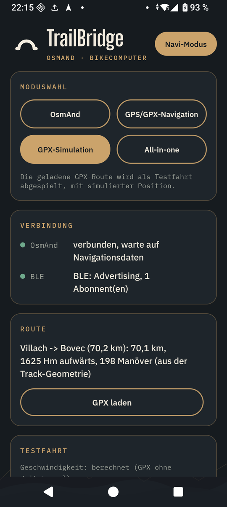
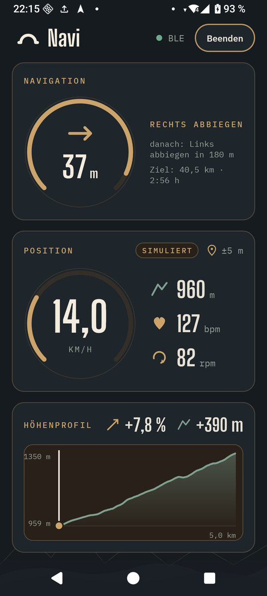

# TrailBridge

*[English version](README.en.md) -- bei Änderungen die englische Fassung mitziehen.*

Android-Companion-App zum
[TRGB-BikeComputer](https://github.com/euphi/TRGB-BikeComputer) (ESP32): reicht
Navigation aus OsmAnd oder einer GPX-Route, die GPS-Position und das Höhenprofil
der Strecke voraus per BLE weiter.

> ## 📖 Anleitung, Bedienung und Screenshots: <https://euphi.github.io/TRGB-BikeComputer/de/trailbridge/>
>
> Die ausführliche Dokumentation liegt **nicht in diesem Repo, sondern auf github.io**, zusammen mit
> der des BikeComputers ([English](https://euphi.github.io/TRGB-BikeComputer/trailbridge/)).
> Diese README ist nur der Überblick für Entwickler.

  
  
  

## Was TrailBridge macht

- **OsmAnd-Navigation weiterreichen:** liest sie per AIDL-API (Manöver, Straßennamen,
  übernächstes Manöver, Fahrspuren, Restdistanz/-zeit) und funkt sie als kompaktes
  TLV-Protokoll per BLE an den BikeComputer -- [PROTOCOL.md](PROTOCOL.md)
  ([English](PROTOCOL.en.md)).
- **GPS-Position:** eigener BLE-Service mit der Position direkt vom GPS-Chip, auch ohne
  OsmAnd; stellt die Uhr des BikeComputers.
- **GPX-Routen:** öffnen, teilen oder laden, "Route starten" -- TrailBridge navigiert selbst,
  ohne OsmAnd. Dazu das **Höhenprofil** der Strecke voraus (mit Ansage der Anstiege) und eine
  **Streckenübersicht** (Ziel, Wegpunkte, Anstiege) als eigene BLE-Services.
- **Geplante Routen:** holt die im eigenen BikeLog-Dienst (BikeComputer-Projekt) markierte
  Route automatisch ab, lädt sie, legt sie auf Wunsch in OsmAnds Track-Liste und startet sie
  mit "In OsmAnd starten" dort direkt. Die einzige Funktion mit Netzzugriff (`INTERNET`);
  ohne eingetragene Adresse bleibt sie aus.
- **Testfahrt:** spielt die geladene GPX als Fake-Position samt simulierten Sensorwerten ab
  (immer als "simuliert" gekennzeichnet) -- zum Testen ohne Fahrt.
- **Navi-Modus und Moduswahl:** ein reduzierter Screen für unterwegs; der Hauptscreen zeigt
  nur, was der gewählte Modus braucht.

## Stand

Die OsmAnd-Navigation und die GPS-Position sind auf echten Fahrten erprobt. Was in welcher
Version dazukam und wie weit es getestet ist, steht in der [Roadmap](ROADMAP.md) und in den
[Release Notes](RELEASE-NOTES-0.5.1.md); APKs unter
[Releases](https://github.com/euphi/TrailBridge/releases).

## Für Entwickler

| | |
|---|---|
| Bauen und Release | [BUILD.md](BUILD.md), F-Droid: [FDROID.md](FDROID.md) |
| BLE-Protokoll (verbindlich für App und Firmware) | [PROTOCOL.md](PROTOCOL.md) |
| Firmware-Seite der Streckenübersicht | [FIRMWARE-OVERVIEW.md](FIRMWARE-OVERVIEW.md) |
| Design (Rim & Ridge, wie der BikeComputer) | [DESIGN.md](DESIGN.md) |
| Offenes und Geplantes | [ROADMAP.md](ROADMAP.md) |
| Analysen | [BROUTER-VOICEHINTS.md](BROUTER-VOICEHINTS.md), [LANE-COUNT-BUG.md](LANE-COUNT-BUG.md) |

- **Unit-Tests:** `gradle testDebugUnitTest` (reines Java ohne Android-Abhängigkeit; der Abruf
  geplanter Routen läuft gegen einen kleinen HTTP-Server im Test).
- **AIDL:** Die Dateien unter `app/src/main/aidl/` und `app/src/main/java/net/osmand/aidlapi/`
  sind 1:1 aus OsmAnds [AIDL-API](https://github.com/osmandapp/OsmAnd/tree/master/OsmAnd-api)
  übernommen.
- **Ohne BikeComputer** lässt sich der BLE-Teil mit jeder BLE-Scanner-App prüfen, z. B.
  [nRF Connect](https://www.nordicsemi.com/Products/Development-tools/nrf-connect-for-mobile);
  `adb logcat -s OsmAndLink -s BikeGatt` zeigt die Daten als Log.

## Lizenz

Copyright (C) 2026 Ian

TrailBridge steht unter der [GNU General Public License v3.0 oder später](LICENSE)
(GPL-3.0-or-later). Die übernommenen OsmAnd-AIDL-Dateien
(`net.osmand.aidlapi.*`) stammen aus dem GPLv3-lizenzierten
[OsmAnd-Repo](https://github.com/osmandapp/OsmAnd) (© OsmAnd BV).

Die gebündelten Schriften (Big Shoulders Display, IBM Plex Sans/Mono) stehen unter der
SIL Open Font License 1.1, nicht unter der GPL -- Herkunft und Lizenztexte in
[fonts/](fonts/README.md).
